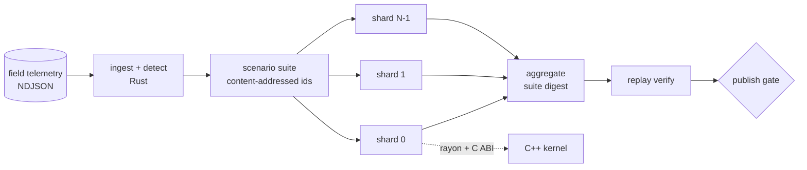

# Autonomous Fleet Simulation Engine

A deterministic simulator that stress-tests an autonomous ride-hailing fleet against adversarial conditions, plus the
pipeline that turns raw vehicle telemetry into reproducible test scenarios and runs them at scale.

- **C++17 kernel** simulates a fleet (demand, dispatch, vehicle dynamics) and injects five classes of faults: GPS spoofing, sensor dropout, demand surges, dispatch latency and phantom ride requests.
- **Rust orchestrator (`fleetctl`)** ingests telemetry, detects anomalous episodes, builds a content-addressed scenario suite, and runs it in parallel and in shards. It links the C++ kernel through a stable C ABI.
- **Apache Airflow** sequences the validation cycle: acquire, ingest, quality gate, build scenarios, sharded fan-out, aggregate, replay-verify, publish gate.
- **Kubernetes** runs the shards as an Indexed Job: one pod per shard, no coordinator.

> **Read this first.** There is no real vehicle data in this repository. The telemetry is *synthetic*: a generator emits a
> realistic-but-artificial feed (duplicates, late records, corrupt lines, packet loss) and injects anomalies whose true
> positions are known, so the detection stage can be scored against ground truth. All metrics below were measured on this
> code; the benchmark protocol and its limits are in [Methodology](#methodology-and-caveats).

## Results at a glance

| Area | Measured result |
|---|---|
| Simulation throughput | **73 scenarios/s on one thread (52 M vehicle-ticks/s), 412 scenarios/s on 12 threads** (5.7x on a 6-core / 12-thread CPU) |
| Determinism | **Bit-identical results** across 1/2/4/8/12 threads, a 5-way shard split, 1/2/4/8 Kubernetes pods, and every sampled replay (0 mismatches) |
| Engine correctness | **0 invariant violations** in every run; 10,236 C++ checks and 7 Rust integration tests pass |
| Telemetry ingest | **1.10 M records (83 MB) in 0.25 s** on 12 threads (4.4 M records/s); 0.50 s on one thread |
| Anomaly detection | **0.95 precision / 0.83 recall** against 144 injected anomalies over 6 feeds (0.94 / 0.82 on the 5 held-out feeds) |
| Validation cycle time | **-51 % on a 1,142-scenario suite, -73 % on 4,442 scenarios**, versus a sequential single-worker baseline producing identical results. Only -7% at 262 scenarios, where fixed overhead dominates (see below) |
| Kubernetes | Airflow `KubernetesPodOperator` ran 4 shard pods on a 3-node `kind` cluster; replayed results matched with 0 mismatches |

Raw data: [`bench/results/`](bench/results). Everything below is regenerated by `scripts/bench_all.sh`.

## How it works



1. **Ingest and detect.** Parse in parallel, drop malformed lines, sort and de-duplicate, then scan each vehicle's track for GPS discontinuities and silent gaps and each map tile for demand, cancellation and assignment-delay anomalies. Adjacent flagged tiles and windows merge into *episodes* (type, onset, duration, centre, radius, estimated intensity). Detectors are transparent threshold rules, not a trained model.
2. **Build scenarios.** Every episode becomes seeded replications, plus compound scenarios (two episodes overlapping) and fault-free controls. A scenario's id is the SHA-256 of its canonical JSON, and seeds and onset offsets are hashes of stable identifiers, so the same telemetry always yields byte-identical scenarios.
3. **Run.** `fleetctl run` simulates scenarios on a worker pool, each call going through `fleet_run()` in the C++ kernel. `--shard i/N` selects the scenarios whose position in id order is `i mod N`. On Kubernetes an Indexed Job gives each pod its index through `JOB_COMPLETION_INDEX`.
4. **Judge.** Each run is checked against an SLA (p95 rider wait, abandon rate, road congestion) and against the engine's own invariants. SLA failures are *findings*; invariant violations are engine bugs and fail the pipeline.
5. **Prove reproducibility.** `aggregate` hashes every `id:state_hash` pair into a suite digest, and `verify` re-simulates a sample on a different thread count and compares state hashes.

The simulation model, fault semantics, detection rules and determinism contract are documented in [`docs/architecture.md`](docs/architecture.md).

## Quickstart

Requirements: a C++17 compiler, Rust (stable), Python 3. Airflow, Docker, `kind` and `kubectl` are only needed for the pipeline and cluster steps.

```bash
make test        # C++ kernel tests + Rust integration tests
make demo        # telemetry -> detect -> scenarios -> simulate -> report -> replay-verify
```

`make demo` prints a validation report and a suite digest. On the machine used for this README the digest is
`eb6582a8eed11bc82e4be26ff518e36904d7edd9a63fd6c899d6ba0be452d2b7`; it is identical across runs and thread counts.
Bit-identity is guaranteed for a fixed binary and CPU architecture, not across different ones.

Run one scenario with the standalone C++ CLI:

```bash
make -C core
core/build/fleetsim --seed 7 --fault demand_surge:300:150:32:40:12:6
```

Run the pieces yourself:

```bash
F=orchestrator/target/release/fleetctl
$F telemetry-gen --out data/t.ndjson --truth data/truth.json --seed 1
$F ingest        --input data/t.ndjson --out data/ingest.json
$F score         --ingest data/ingest.json --truth data/truth.json      # precision / recall
$F scenarios     --ingest data/ingest.json --out data/scenarios.ndjson
$F run           --scenarios data/scenarios.ndjson --out-dir data/results --shard 0/4
$F aggregate     --results-dir data/results --report data/report.json --markdown data/report.md
$F verify        --scenarios data/scenarios.ndjson --results-dir data/results
```

### Airflow

```bash
scripts/setup_airflow.sh                 # pins Airflow 2.10.5 with the official constraints file
source scripts/airflow_env.sh && "$AIRFLOW_BIN" db migrate
scripts/run_pipeline.sh 2026-10-27       # one full validation cycle through the DAG
```

The DAG is [`pipelines/airflow/dags/fleet_telemetry_to_scenarios.py`](pipelines/airflow/dags/fleet_telemetry_to_scenarios.py).
It is configured entirely by environment variables (`FLEET_SHARDS`, `FLEET_EXEC_MODE`, `FLEET_SEEDS_PER_EVENT`, ...) so the same file runs on a laptop and on a cluster.

### Kubernetes

```bash
scripts/k8s_up.sh                                               # 3-node kind cluster, image built and loaded
SHARDS=4 THREADS=1 scripts/k8s_run_suite.sh out/demo/scenarios.ndjson   # Indexed Job, then aggregate
umask 000; FLEET_EXEC_MODE=kubernetes FLEET_WORK_DIR=$PWD/out/k8s \
  FLEET_SHARDS=4 FLEET_SHARD_THREADS=1 scripts/run_pipeline.sh          # Airflow creating the pods
scripts/k8s_down.sh
```

Manifests are in [`deploy/k8s/`](deploy/k8s). The storage is a `hostPath` volume that only makes sense on a local `kind`
cluster; use a ReadWriteMany volume or an object store on a real one.

## Measured results

Environment: Intel Core i7-9750H (6 cores / 12 threads), 16 GB, macOS 26.6; Apple clang 17, rustc 1.99.1, Python 3.9.6,
Airflow 2.10.5, kind v0.33.0 (Kubernetes v1.37.0), Docker Desktop 29.6.2.

### Simulation throughput

460 scenarios (500 vehicles, 128 x 128 city, 4 simulated hours each), median of 3 runs, range in parentheses.

| threads | seconds | scenarios/s | M vehicle-ticks/s | speed-up | efficiency |
|---:|---:|---:|---:|---:|---:|
| 1 | 6.34 (6.19-6.41) | 73 | 52 | 1.00x | 100% |
| 2 | 3.25 (3.23-3.29) | 141 | 102 | 1.95x | 97% |
| 4 | 1.88 (1.85-1.91) | 245 | 176 | 3.38x | 84% |
| 8 | 1.28 (1.25-1.29) | 359 | 259 | 4.95x | 62% |
| 12 | 1.12 (1.10-1.14) | 412 | 297 | 5.68x | 47% |

Efficiency drops past 6 threads because the CPU has 6 physical cores; the 12 logical threads share them. The suite digest
was identical for every thread count in every run.

### Telemetry ingest and anomaly detection

Ingest of a 6-hour, 500-vehicle feed: 1,102,393 lines (83 MB), including about 11 k duplicates, 1.1 k truncated lines and
late or out-of-order records.

| threads | median seconds | records/s |
|---:|---:|---:|
| 1 | 0.504 | 2.19 M |
| 12 | 0.248 | 4.44 M |

Detection quality against the anomalies the generator injected (24 per feed, 5 fault types). The detector thresholds were
set while looking at feed 1; feeds 2-6 are held out.

| feeds | injected | detected | matched | precision | recall |
|---|---:|---:|---:|---:|---:|
| all (6) | 144 | 126 | 120 | 0.95 | 0.83 |
| held-out only (5) | 120 | 105 | 99 | 0.94 | 0.82 |

| fault type | injected | detected | matched | recall | precision |
|---|---:|---:|---:|---:|---:|
| demand_surge | 34 | 35 | 32 | 0.94 | 0.91 |
| dispatch_latency | 37 | 21 | 21 | **0.57** | 1.00 |
| gps_spoof | 21 | 20 | 19 | 0.90 | 0.95 |
| phantom_requests | 22 | 21 | 21 | 0.95 | 1.00 |
| sensor_dropout | 30 | 29 | 27 | 0.90 | 0.93 |

Dispatch-latency episodes are the weak spot: they only touch the few requests that fall inside a small region, so many
episodes carry too little evidence to flag. I did not tune further, because that would only fit the generator.

### Validation cycle time

A *validation cycle* is the wall-clock time from a raw telemetry batch (6 h, 500 vehicles, 1.1 M records) to a published
pass/fail report over the derived scenario suite, including the replay check and the publish gate.

- **Baseline:** the same binaries run stage by stage, single-threaded, one scenario at a time (`--threads 1`), no orchestration.
- **Pipeline:** the Airflow DAG with 4 shards, using every core.
- Runs are interleaved (baseline, pipeline, baseline, ...) so machine drift affects both. Both must produce the identical suite digest, otherwise the benchmark aborts.

| scenarios | runs | baseline (min-max) | pipeline (min-max) | cycle-time change | speed-up | same results |
|---:|---:|---:|---:|---:|---:|:---:|
| 262 | 3 | 6.6 s (6.5-6.9) | 6.1 s (6.0-6.2) | -7.3% | 1.08x | yes |
| 482 | 5 | 8.8 s (8.7-9.3) | 5.9 s (5.8-8.1) | -32.4% | 1.48x | yes |
| 1,142 | 5 | 18.6 s (17.7-20.8) | 9.1 s (7.5-9.5) | -51.3% | 2.05x | yes |
| 2,242 | 3 | 35.7 s (35.2-36.7) | 10.0 s (9.9-11.9) | -72.1% | 3.58x | yes |
| 4,442 | 3 | 67.8 s (65.7-68.8) | 18.2 s (17.5-18.4) | -73.1% | 3.71x | yes |

How to read this honestly:

- The gain depends on suite size. The pipeline carries a fixed orchestration cost (Airflow start-up and per-task process spawning), so a small suite barely benefits and the benefit grows as simulation time starts to dominate.
- In local mode `airflow dags test` runs tasks one after another, so the speed-up here comes from the parallel runner inside each shard task, not from Airflow running tasks concurrently. On Kubernetes the shards are concurrent pods.
- The baseline is a deliberately simple single-worker workflow, not a tuned alternative. It is a fair comparison for "sequential vs orchestrated and parallel", not for "this vs the best possible script".

### Kubernetes

The same 461-scenario suite run as an Indexed Job with 1, 2, 4 and 8 pods produced the identical suite digest every time.
An Airflow run with `FLEET_EXEC_MODE=kubernetes` created 4 shard pods through `KubernetesPodOperator`, and a local replay of
100 scenarios matched the pod output exactly (146 scenarios, 0 invariant violations).

I am not publishing Kubernetes scaling numbers. The Docker VM was shared with unrelated, CPU-saturating containers during
those runs, so the wall times are not a valid scaling benchmark. `scripts/bench_k8s.sh` reproduces the measurement on a quiet cluster.

## What the reference city shows

Reference city: 500 vehicles, 128 x 128 cells, 4 simulated hours, demand profile estimated from telemetry. SLA: p95 wait at most 10 min,
abandon rate at most 1 %, at most 200 congestion events. Results for the 461-scenario demo suite (`make demo`):

| group | scenarios | pass rate | mean p95 wait (ticks) | mean abandon rate |
|---|---:|---:|---:|---:|
| control (no fault) | 20 | 100.0% | 42.4 | 0.00% |
| gps_spoof | 80 | 96.2% | 44.7 | 0.00% |
| sensor_dropout | 100 | 95.0% | 45.5 | 0.01% |
| dispatch_latency | 40 | 97.5% | 43.9 | 0.00% |
| phantom_requests | 40 | 50.0% | 69.0 | 0.00% |
| demand_surge | 160 | 0.0% | 90.3 | 8.02% |
| compound (two faults) | 21 | 33.3% | 74.6 | 7.45% |

Fault-free controls must pass: if they do not, the engine or the SLA is wrong. These numbers describe *this simple city model*,
not any real operator.

## Methodology and caveats

- **Synthetic telemetry.** Generated by `fleetctl telemetry-gen`. Event positions are known, which is what makes precision and recall measurable, but real feeds will be messier.
- **Simple model.** Grid roads, greedy nearest-vehicle dispatch, one speed. The point is a reproducible harness for adversarial scenarios, not a calibrated market model.
- **Heuristic intensities.** Fault intensities estimated from telemetry are monotone mappings from the evidence, not fitted physics.
- **Quiet-machine protocol.** Benchmarks ran after quitting Docker Desktop. An earlier set taken while unrelated containers loaded the CPU showed 2x slower single-thread throughput and large run-to-run spread, and was discarded.
- **Single machine.** All timings are from one laptop. Relative comparisons within a table are more meaningful than absolute values.
- **Determinism scope.** Bit-identical for a fixed binary and CPU architecture. The kernel uses its own PRNG and `-ffp-contract=off`, but I have not verified identity across compilers or architectures.
- **CI is configured but unverified.** [`.github/workflows/ci.yml`](.github/workflows/ci.yml) runs the same commands used locally; it has not been observed running on GitHub.

## Repository layout

```
core/             C++17 simulation kernel, standalone CLI and 10k+ assertion test suite
orchestrator/     Rust crate `fleetctl`: ingest, detection, scenarios, runner, reports (+ integration tests)
pipelines/airflow Airflow DAG and requirements
deploy/k8s/       Namespace, storage, Indexed Job and kind cluster template
scripts/          demo, Airflow/Kubernetes helpers, benchmark drivers
bench/            summarizer and raw benchmark results
docs/             architecture, simulation model, determinism contract
```

## License

MIT. See [LICENSE](LICENSE).
