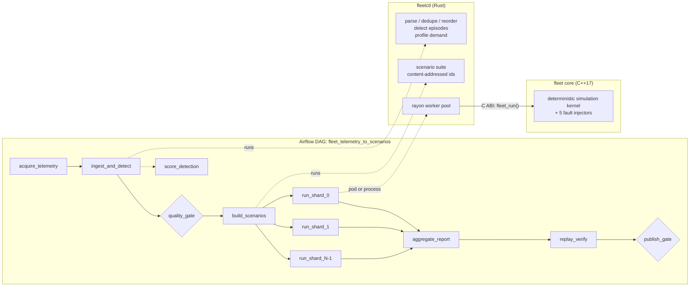

# Architecture

## Data flow

| Layer | Language | Responsibility |
|---|---|---|
| Simulation kernel | C++17 | One scenario in, one metrics record out. Pure function of the scenario, re-entrant, no global state. |
| Orchestrator `fleetctl` | Rust | Telemetry ingest, anomaly detection, scenario construction, parallel/sharded execution, aggregation, replay verification. Calls the kernel over a stable C ABI. |
| Pipeline | Python / Airflow | Sequencing, retries, fan-out, data-quality gate, publish gate. Contains no simulation logic. |
| Deployment | Kubernetes | Indexed Job: one pod per shard; the pod derives its shard from `JOB_COMPLETION_INDEX`. |

## Why the C++/Rust split

The kernel is a tight numeric loop over a few hundred vehicles per tick, so it is written in C++ and kept
free of allocation in the hot path other than per-run buffers. Everything around it (parsing hundreds of MB of
NDJSON, graph of work, parallelism, hashing, CLI) is where Rust's safety and `rayon` pay off. The boundary is a
single function, `fleet_run(const fleet_scenario_t*, fleet_metrics_t*)`, with plain-old-data structs. Both sides
assert `sizeof` of those structs at start-up, so a layout drift fails loudly instead of corrupting results.

## Simulation model

- City: `grid x grid` cells (default 128 x 128, one cell = 100 m). One tick = 10 s; a vehicle moves one cell per tick
  along a Manhattan route (x first, then y).
- Demand: Poisson arrivals with a diurnal curve, a configurable share clustered around up to four hotspots.
- Dispatch: FIFO requests, each matched to the nearest idle vehicle *as perceived by the dispatcher*, found through a
  bucketed spatial index with an exact early-exit bound. A rider abandons a request that stays unassigned for
  `max_wait_ticks`.
- Safety/consistency invariants are checked inside the run (request conservation, vehicle/request cross-references,
  bounds). Any breach increments `invariant_violations`, which is a hard failure in the pipeline.

### Adversarial faults

| Fault | What it does inside the region | `intensity` means |
|---|---|---|
| `gps_spoof` | The dispatcher sees displaced positions for affected vehicles (constant per-vehicle bias). Mis-dispatch, longer real pickups. | fraction of vehicles affected |
| `sensor_dropout` | Affected vehicles freeze for the duration; riders in frozen vehicles are stranded, waiting riders eventually cancel. | fraction of vehicles affected |
| `demand_surge` | Extra localised ride requests. | extra request rate as a multiple of the base rate |
| `dispatch_latency` | Requests picked up inside the region are skipped by the dispatcher with this probability each tick. | stall probability per tick |
| `phantom_requests` | Spoofed requests with no rider; a vehicle drives there and wastes the trip. | phantom rate as a multiple of the base rate |

## Determinism contract

For a fixed scenario, binary and CPU architecture, the result is bit-identical on every run and on every thread.
What makes that true:

1. **Own PRNG.** xoshiro256** seeded by SplitMix64. `<random>` distributions are not specified bit-for-bit across
   standard libraries, so they are not used.
2. **Independent streams.** Demand draws come from one stream that faults never touch. Fault decisions are a pure hash
   of `(seed, fault, entity)`, so adding a fault does not shift the demand stream and a faulted run can be compared
   against its clean twin.
3. **No fused multiply-add** (`-ffp-contract=off`) so floating point results do not depend on the compiler's contraction choices.
4. **Total ordering.** Ties in dispatch break on vehicle id; shard membership is decided by position in id order.
5. **Content-addressed scenarios.** A scenario id is the SHA-256 of its canonical JSON; seeds and onset offsets are
   hashes of stable identifiers. Re-running the pipeline on the same telemetry yields byte-identical ids.
6. **Suite digest.** SHA-256 over sorted `id:state_hash` pairs. Equal digests prove two runs of a suite (any thread count,
   any shard layout, local or Kubernetes) produced identical simulations. `fleetctl verify` and the benchmarks assert this.

## Telemetry ingest and event detection

The ingest stage never trusts the feed: it parses in parallel, drops malformed lines, sorts and de-duplicates
heartbeats on `(vehicle, timestamp)` and requests on `request id`, then scans each vehicle's track.

Detection is a transparent rule set over 16-cell tiles and 5-minute windows (not a trained model). A tile-window is
flagged when it crosses a threshold; flagged cells that touch in space (one tile) and time (two windows) are merged
into one episode.

| Episode | Evidence | Rule |
|---|---|---|
| GPS spoof | position jump > 6 cells between consecutive heartbeats | >= 4 jump endpoints in the tile-window |
| Sensor dropout | silent gap > 3 ticks | >= 2 gap starts in the tile-window |
| Demand surge | request count vs the tile's own median | >= 12 requests and >= 3x median, cancel ratio < 0.5 |
| Phantom requests | cancel ratio | >= 8 requests and >= 60 % cancelled |
| Dispatch latency | assignment delay | >= 2 requests, total delay >= 12 ticks, mean >= 4 ticks |

Each episode becomes a fault (type, onset, duration, centre, radius, estimated intensity). The baseline demand
rate is estimated from windows *not* touched by a demand-inflating episode, because a plain median is biased when
such episodes cover most windows. Intensity estimates are simple monotone mappings from the evidence, not fitted
physical parameters.

## Scenario suite

For every detected episode the suite contains N seeded replications; it also contains compound scenarios (two
episodes overlapping) and fault-free controls. Controls must pass the SLA: if they do not, the engine or the SLA is
wrong, not the platform under test.

## Scaling out

`fleetctl run --shard i/N` takes the scenarios whose position in id order is `i mod N`. On Kubernetes an Indexed Job
creates N pods and each takes `i` from `JOB_COMPLETION_INDEX`, so shards need no coordinator. Shard files are written to a
temporary file and renamed, so a retried pod can never leave a half-written result; `aggregate` de-duplicates by
scenario id, which makes at-least-once execution safe.

## Known limits

- The telemetry is synthetic (generated with injected, known anomalies). There is no real vehicle data in this repository.
- The kernel is a deliberately simple city model (grid roads, greedy dispatch), not calibrated to any real market.
- Intensities mapped from telemetry are heuristics; they make scenarios plausible and reproducible, not physically exact.
- The Kubernetes storage in `deploy/k8s/storage.yaml` is a `hostPath` volume for local `kind` clusters only.
- Determinism is guaranteed for a fixed binary and CPU architecture; bit-identity across different architectures is not claimed.
